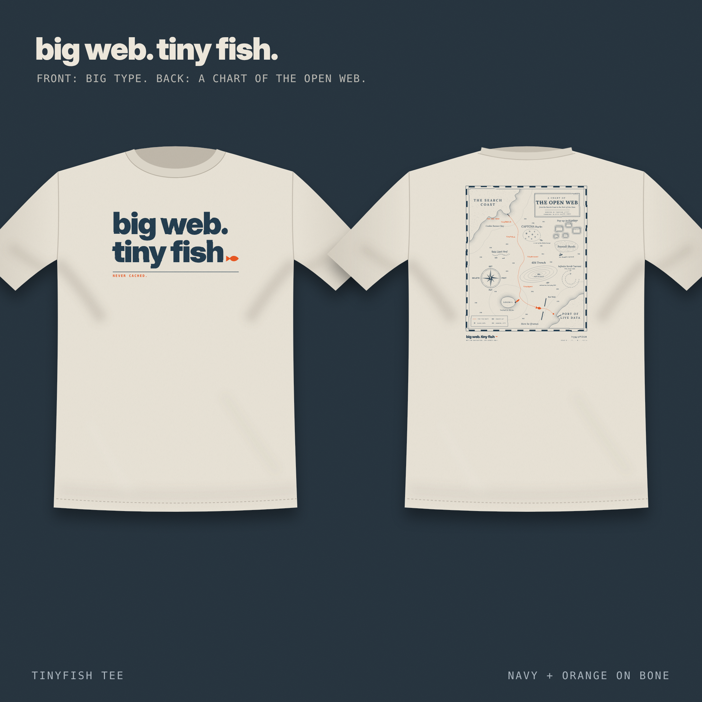
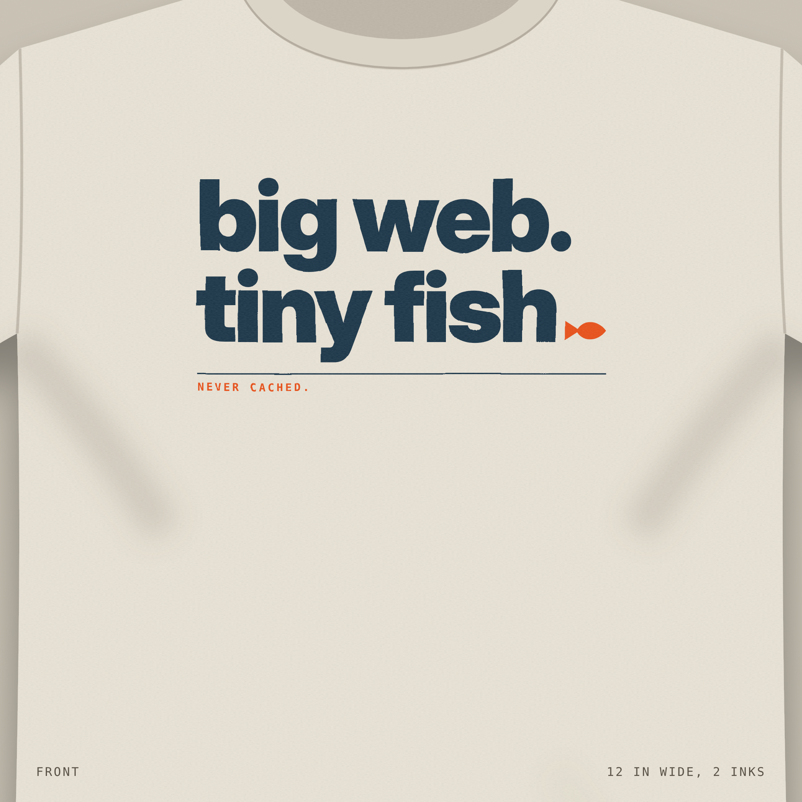
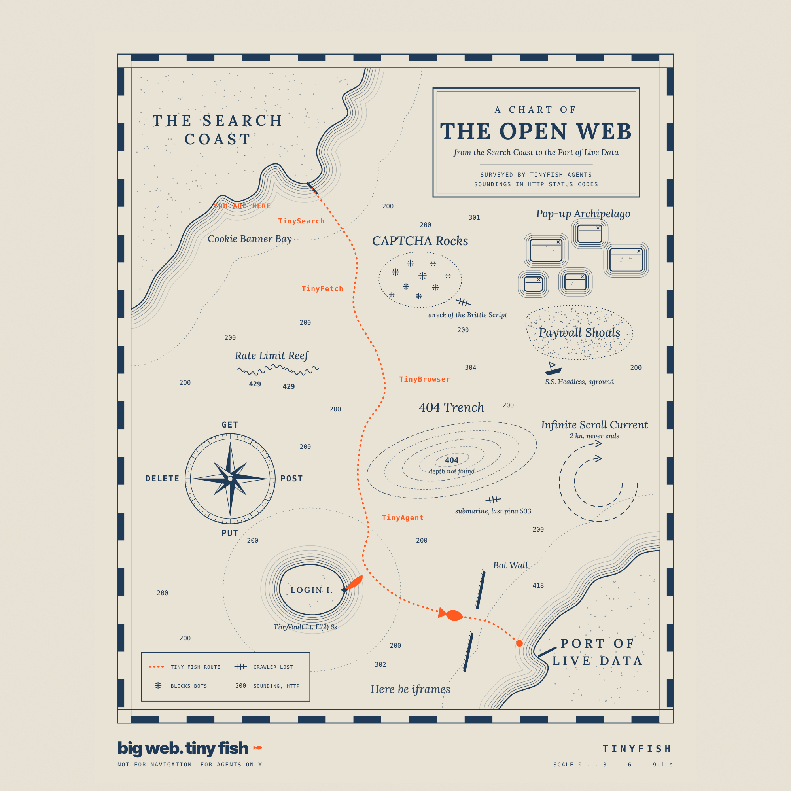
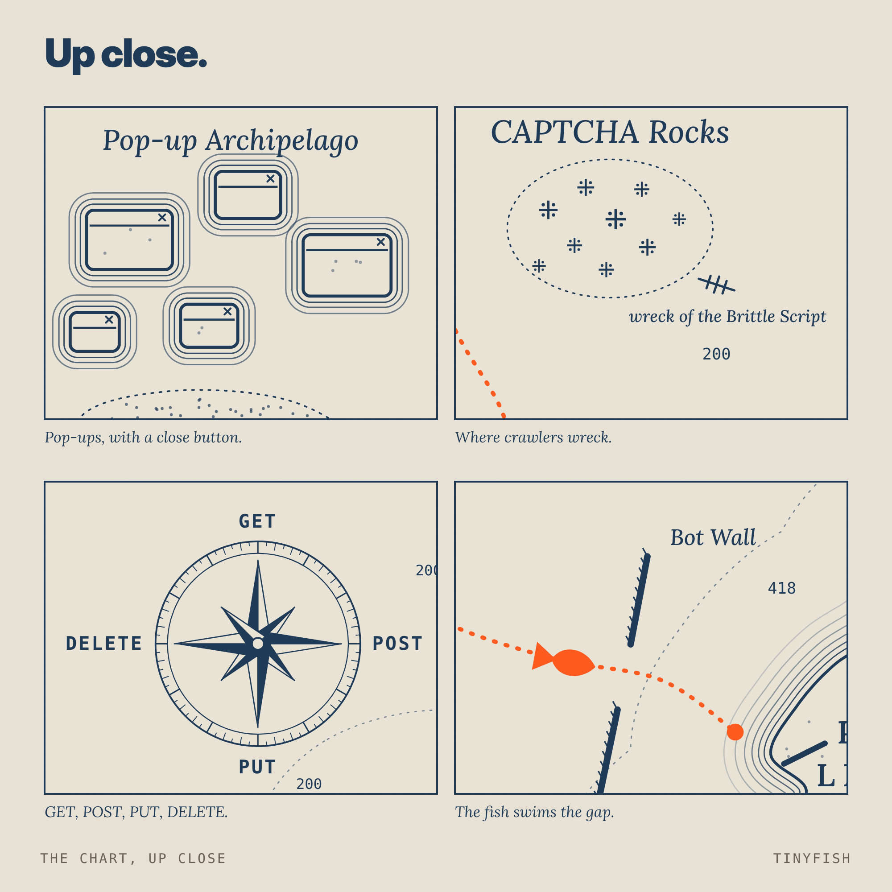
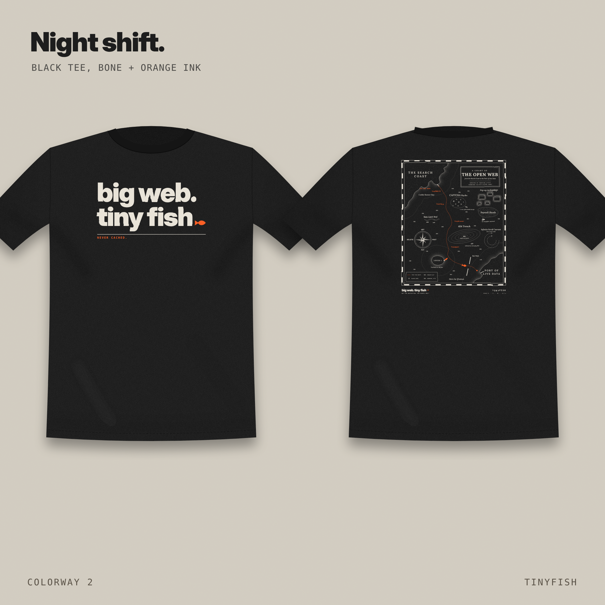
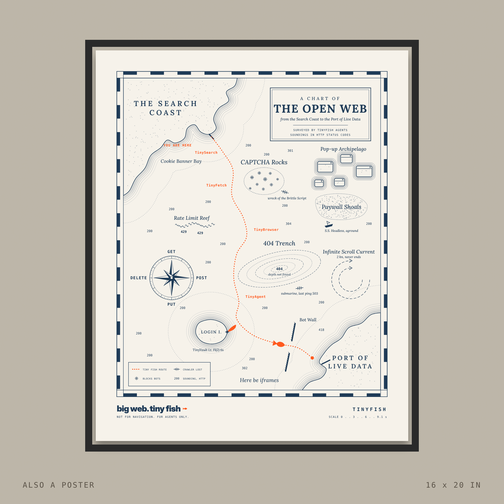

# big web. tiny fish.

A two-ink TinyFish tee for the [TinyMerch Challenge](https://tinymerch.shop/). Big type on the front. A sea chart of the internet on the back.

## The idea

Homer Wang, TinyFish's Head of Product, put it like this at HumanX 2026:

> If everyone else is busy building ships and submarines to explore the ocean, which is the web, we're busy getting you the tiny fish.

([source](https://workos.com/blog/homer-wang-tinyfish-ai-agents))

The design is inspired by it. The web is a big, hostile sea: CAPTCHAs, paywalls, pop-ups, rate limits. Crawlers built like ships run aground. A TinyFish agent is the native creature of that sea, so it swims straight through and comes back with the data.

## Front

**big web. tiny fish.** The problem first, then the name. The orange fish is the full stop, so the last thing you see is the brand, as a word and as a mark. Under the rule: NEVER CACHED.

## Back: A Chart of the Open Web

Drawn like an old nautical chart, surveyed by TinyFish agents. Soundings are HTTP status codes. Not for navigation. For agents only.

What is on the chart:

* **CAPTCHA Rocks:** where crawlers wreck. Wreck of the Brittle Script.
* **404 Trench:** depth not found. A submarine, last ping 503.
* **Paywall Shoals:** S.S. Headless, aground.
* **Pop-up Archipelago:** islands with a close button.
* **Rate Limit Reef:** soundings of 429.
* **Infinite Scroll Current:** 2 knots, never ends.
* **Login Island:** the TinyVault lighthouse, Fl(2) 6s.
* **Bot Wall:** the fish swims through the gap.
* **Compass rose:** points GET, POST, PUT and DELETE.
* **The route:** TinySearch, TinyFetch, TinyBrowser, TinyAgent, then the Port of Live Data.

## Colorways and poster

* **Bone tee:** navy + orange ink.
* **Black tee:** bone + orange ink.
* **Poster:** the chart at 16 x 20 in.

## Print files

Everything is in [`print_files/`](print_files/). Full details are in [`print_spec_v4.md`](print_files/print_spec_v4.md).

* Front: 4800 x 2700 px, transparent, 12 x 6.75 in at 400 ppi. One file per colorway.
* Back: 4800 x 6000 px, transparent, 12 x 15 in at 400 ppi. One file per colorway.
* Ink separations for 2-screen printing (black = ink).
* Vector SVGs with live text.
* Poster PDF, 16 x 20 in.

DTG prints everything as is. A 2-screen print needs halftones for the light coast lines and a fine mesh for the smallest text.

## Notes

* This is a merch design. The challenge says no TinyFish endpoint usage is required. TinyFish is the subject.
* The chart's place names are jokes, not real places.
* The TinyFish name is used as the challenge rules allow. Swap the plain "TINYFISH" text for the official logo before production.

Vote on the wall: [tinymerch.shop](https://tinymerch.shop/)# big_web-tiny_fish
